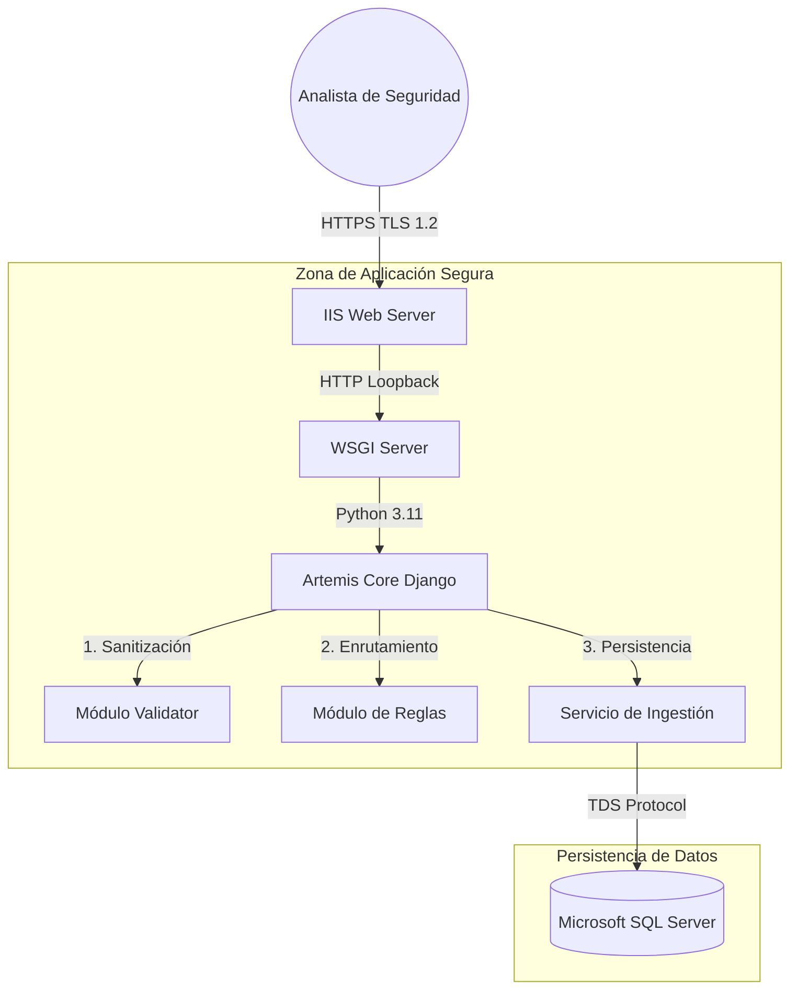
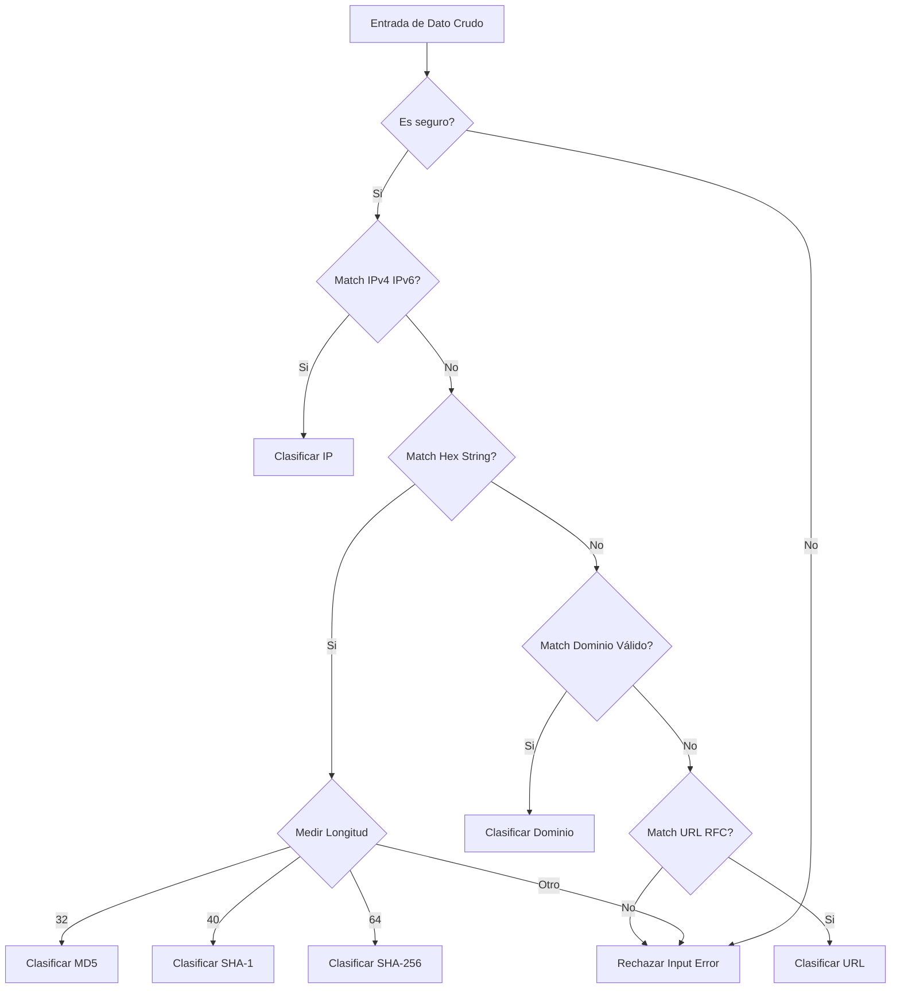
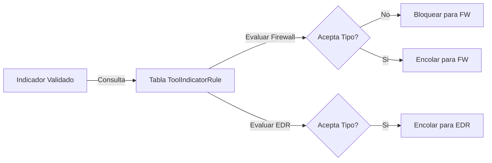
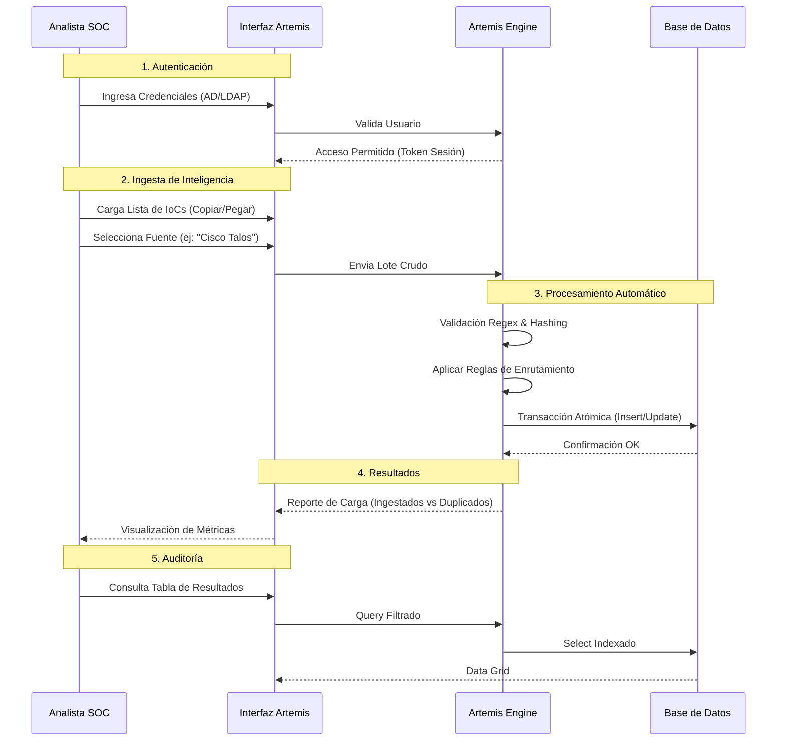
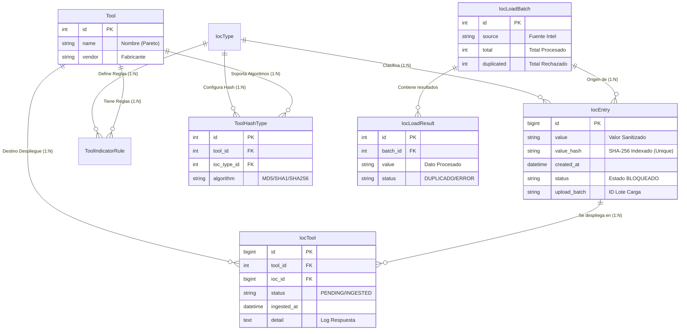

# Documentación Técnica y Funcional: Proyecto Artemis
**Confidencial - Uso Interno Exclusivo**

---

## 1. Resumen Ejecutivo

**Artemis** es una plataforma centralizada de orquestación de inteligencia de amenazas (Threat Intelligence Orchestration), diseñada para la gestión, normalización y distribución segura de Indicadores de Compromiso (IoCs).

El sistema responde a la necesidad crítica de la entidad bancaria de reducir el tiempo de respuesta ante incidentes de ciberseguridad, permitiendo la ingesta masiva y validada de indicadores (IPs, Hashes, Dominios, URLs) y su posterior sincronización con herramientas defensivas perimetrales y de endpoint (EDR, Firewalls, Proxies).

---

## 2. Objetivos del Proyecto

### 2.1. Objetivo General
Optimizar la postura de ciberseguridad de la entidad mediante una plataforma unificada que garantice la integridad, unicidad y correcta clasificación de los indicadores de compromiso antes de su despliegue en la infraestructura de seguridad.

### 2.2. Objetivos Específicos
*   **Integridad de Datos:** Eliminar duplicidad y errores de formato en la ingesta de IoCs mediante validación estricta y criptográfica.
*   **Eficiencia Operativa:** Automatizar la clasificación y distribución de indicadores, liberando horas-hombre de los analistas de SOC.
*   **Optimización de Recursos:** Garantizar un bajo consumo de almacenamiento en base de datos (meta < 500MB) mediante un modelo normalizado "Zero Redundancy".
*   **Trazabilidad:** Mantener una auditoría clara del ciclo de vida del indicador.

---

## 3. Arquitectura de la Solución

### 3.1. Diagrama de Componentes

### 3.1. Diagrama de Componentes



### 3.2. Descripción Detallada de Módulos Core

El núcleo de Artemis se compone de tres módulos funcionales interconectados que garantizan la calidad del dato.

#### A. Módulo de Validación (`Validator`)
Actúa como barrera de entrada estricta. Asegura que **ningún dato inválido** llegue a la base de datos.

**Proceso Detallado de Validación:**
El proceso no es binario (pasa/no pasa), sino un análisis profundo del dato:
1.  **Limpieza Inicial:** Se eliminan espacios invisibles (trimming) y caracteres de control (NULL bytes, saltos de línea) que suelen romper parsers aguas abajo.
2.  **Identificación de Patrón:**
    *   **IPs:** Se verifica contra RFC 791 (IPv4) y RFC 4291 (IPv6).
    *   **Hashes:** Aquí reside una lógica crítica. El sistema mide la longitud exacta del string hexadecimal:
        *   **32 caracteres:** Se etiqueta como **MD5**.
        *   **40 caracteres:** Se etiqueta como **SHA-1** (Vital para sistemas legacy).
        *   **64 caracteres:** Se etiqueta como **SHA-256**.
        *   *Cualquier otra longitud (ej: 33 chars) es rechazada instantáneamente.*
3.  **Sanitización de Dominios:** Se comprueba la estructura de TLDs y etiquetas, evitando nombres de host locales o rutas de archivo disfrazadas de dominios.

**Flujo de Lógica:**


#### B. Motor de Reglas (`Routing Engine`)
Decide **hacia dónde** se dirige cada indicador validado, protegiendo a las herramientas de datos incompatibles.

**Lógica de Decisión:**


*   **Matriz de Compatibilidad:** Define reglas estrictas (ej: Firewall solo acepta IPs, EDR acepta Hashes y Dominios).
*   **Protección de Infraestructura:** Previene el envío de configuraciones corruptas a dispositivos perimetrales.

#### C. Servicio de Ingestión (`IngestionService`)
Motor transaccional para operaciones masivas.

*   **Atomicidad:** Garantiza consistencia ACID en la base de datos. Si un lote falla parcialmente por error de integridad, se revierte completamente.
*   **Desduplicación Lógica:** Consulta índices hash SHA-256 antes de insertar, evitando crecimiento innecesario del almacenamiento.

---

## 4. Flujo de Trabajo Operativo (Analista SOC)

Este diagrama describe el procedimiento estándar que sigue un analista de seguridad para operar la plataforma.



---

## 5. Diseño y Modelo de Datos

### 5.1. Diagrama Entidad-Relación Completo (ERD)

Este esquema representa la totalidad de los objetos de datos del sistema, incluyendo tablas de auditoría de carga y configuración de herramientas.



### 5.2. Optimización para Banca
1.  **Zero Redundancy:** Modelo normalizado sin tablas históricas pesadas.
2.  **Indices Hash:** Búsquedas O(1) usando SHA-256 en lugar de cadenas de texto largas.

---

## 6. Controles de Seguridad

### 6.1. Seguridad de Acceso (AAA)
*   **Autenticación Robusta:**
    *   Implementación de `django.contrib.auth`.
    *   **Hashing de Contraseñas:** Algoritmo PBKDF2 con SHA-256 y 600,000 iteraciones (NIST compliant), haciendo computacionalmente inviable el cracking por fuerza bruta.
    *   Gestión de sesiones segura con cookies `HttpOnly` y `SameSite=Lax` para prevenir robo de sesiones (XSS) y ataques cross-site.
    
    **(Evidencia: `settings.py` Configuration)**
    ```python
    MIDDLEWARE = [
        'django.middleware.security.SecurityMiddleware',
        'django.contrib.sessions.middleware.SessionMiddleware',
        'django.middleware.csrf.CsrfViewMiddleware',
        'django.contrib.auth.middleware.AuthenticationMiddleware',
        # ...
    ]
    ```

*   **Autorización (RBAC):**
    *   Modelo de control de acceso basado en roles.
    *   Todos los endpoints API están protegidos por defecto (`IsAuthenticated`).
    
    **(Evidencia: `settings.py` RBAC Default)**
    ```python
    REST_FRAMEWORK = {
        'DEFAULT_PERMISSION_CLASSES': [
            'rest_framework.permissions.IsAuthenticated'
        ],
    }
    ```
    
    **(Evidencia: `views.py` Class Protection)**
    ```python
    class IocViewSet(APIView):
        permission_classes = [permissions.IsAuthenticated]
        # ...
    ```

### 6.2. Protección de Datos y Aplicación (OWASP Top 10)
*   **Prevención de Inyecciones (SQLi):**
    *   La aplicación no construye consultas SQL concatenando cadenas.
    *   Uso exclusivo del ORM de Django que utiliza consultas parametrizadas a nivel de driver ODBC, neutralizando cualquier intento de inyección SQL.
*   **Cross-Site Request Forgery (CSRF):**
    *   Protección activa mediante tokens criptográficos únicos por sesión. Cualquier solicitud de cambio de estado (POST/PUT/DELETE) sin un token válido es rechazada inmediatamente.
*   **Sanitización de Entrada:**
    *   El módulo `Validator` rechaza caracteres de control y secuencias peligrosas antes de cualquier procesamiento.

    **(Evidencia: `models.py` SQL Injection Prevention)**
    ```python
    # El uso de queryset.filter() utiliza parámetros vinculados (bind parameters)
    # a nivel de driver SQL Server, haciendo imposible la inyección.
    IocEntry.objects.filter(value=user_input) 
    ```

### 6.3. Seguridad en Red y Transporte
*   **Cifrado en Tránsito:**
    *   La arquitectura exige TLS 1.2 o superior para todas las comunicaciones Cliente-Servidor.
    *   IIS actúa como punto de terminación SSL seguro, descargando la criptografía del núcleo de la aplicación.
*   **Arquitectura de Proxy Inverso:**
    *   El servidor de aplicación (Waitress) no está expuesto directamente a la red. IIS gestiona las conexiones, filtrado de tramas HTTP malformadas y protección básica contra DDOS.

---

## 7. Evidencia Visual (Capturas de Pantalla)

### 7.1. Inicio de Sesión
Interfaz de autenticación centralizada.
<!-- INSERTAR CAPTURA DE PANTALLA: LOGIN -->

### 7.2. Panel de Control (Dashboard)
Vista unificada del estado de los indicadores.
<!-- INSERTAR CAPTURA DE PANTALLA: DASHBOARD -->

### 7.3. Módulo de Carga Masiva (Ingestión)
Interfaz de procesamiento de listas crudas.
<!-- INSERTAR CAPTURA DE PANTALLA: INGESTION MODAL -->

### 7.4. Auditoría y Resultados
Tabla de trazabilidad.
<!-- INSERTAR CAPTURA DE PANTALLA: RESULTS TABLE -->

---

**Departamento de Ciberseguridad**
**Enero 2026**
