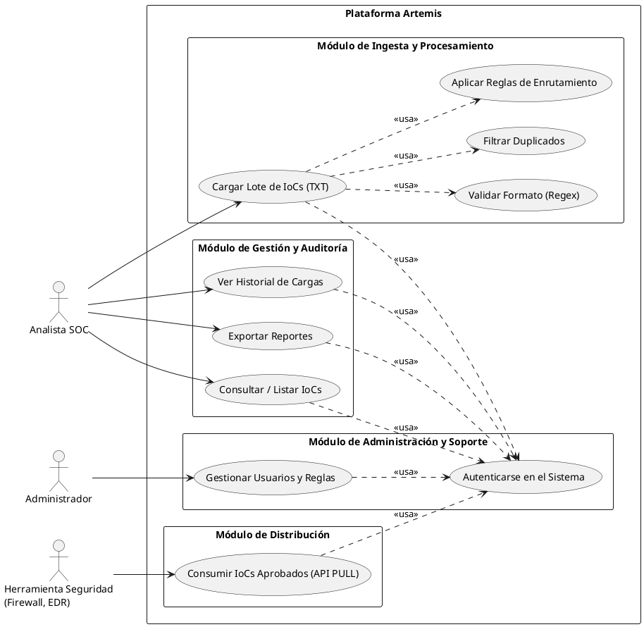
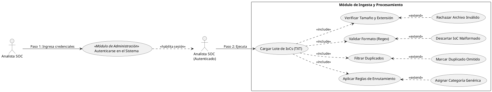
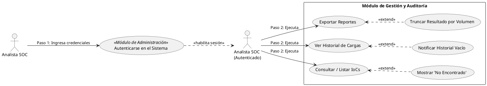
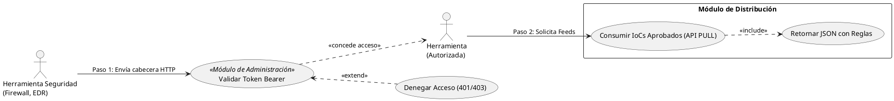
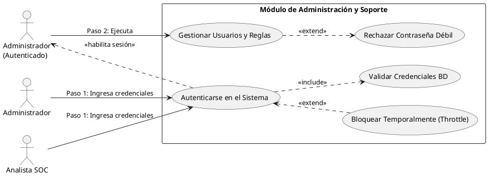

# 5. Diagrama de Casos de Uso del Sistema

A continuación se detalla el Diagrama de Casos de Uso de la plataforma **Artemis**, elaborado a partir de la arquitectura y flujos de datos oficiales. El diagrama refleja las interacciones de los actores con los diferentes módulos y funcionalidades del sistema, utilizando relaciones de inclusión (`<<usa>>`) para denotar dependencias o rutinas compartidas.

## 5.1. Actores del Sistema
1. **Analista SOC (Actor Principal):** Operador de ciberseguridad responsable de la carga, revisión y auditoría de los indicadores de compromiso.
2. **Administrador del Sistema:** Usuario con privilegios elevados encargado de la gestión de roles, permisos y configuración de reglas.
3. **Herramienta de Seguridad (Actor Sistema):** Firewalls, EDR, IPS o WAF que consumen los IoCs validados a través de la API.

---

## 5.2. Descripciones Detalladas de Casos de Uso

A continuación se documentan formalmente las funcionalidades del sistema bajo el estándar tabular requerido.

### Módulo de Ingesta y Procesamiento

<table border="1" style="border-collapse: collapse; width: 100%; margin-bottom: 20px;">
  <tr style="background-color: #00B0F0; color: black;">
    <td style="padding: 5px; width: 15%;"><b>CU-01</b></td>
    <td colspan="3" style="padding: 5px;"><b>Cargar Lote de IoCs (TXT)</b></td>
  </tr>
  <tr>
    <td style="background-color: #E26B0A; color: white; padding: 5px;"><b>Descripción</b></td>
    <td colspan="3" style="padding: 5px;">El Analista SOC sube un archivo TXT con listas de indicadores (IPs, dominios, etc.) para que el sistema inicie su ingesta masiva.</td>
  </tr>
  <tr>
    <td style="background-color: #E26B0A; color: white; padding: 5px;"><b>Actores</b></td>
    <td colspan="3" style="padding: 5px;">Analista SOC</td>
  </tr>
  <tr>
    <td style="background-color: #E26B0A; color: white; padding: 5px;"><b>Pre condiciones</b></td>
    <td colspan="3" style="padding: 5px;">El Analista debe estar autenticado en el sistema (CU-10).</td>
  </tr>
  <tr>
    <td style="background-color: #E26B0A; color: white; padding: 5px;"><b>Post condiciones</b></td>
    <td colspan="3" style="padding: 5px;">El archivo es recibido en memoria y el sistema dispara las validaciones secundarias.</td>
  </tr>
  <tr style="background-color: #00B050; color: black;">
    <td style="padding: 5px;"><b>Secuencia Normal</b></td>
    <td style="padding: 5px; width: 5%;"><b>#</b></td>
    <td style="padding: 5px; width: 40%;"><b>Acción (actor)</b></td>
    <td style="padding: 5px; width: 40%;"><b>Reacción (sistema)</b></td>
  </tr>
  <tr>
    <td rowspan="2"></td>
    <td style="padding: 5px; text-align: center;">1</td>
    <td style="padding: 5px;">Adjunta un archivo `.txt` y presiona "Procesar".</td>
    <td style="padding: 5px;">Recibe el archivo, verifica el tamaño y peso permitido.</td>
  </tr>
  <tr>
    <td style="padding: 5px; text-align: center;">2</td>
    <td style="padding: 5px;">Espera la confirmación visual.</td>
    <td style="padding: 5px;">Invoca el CU-02 (Regex) e informa el resumen de la carga.</td>
  </tr>
  <tr style="background-color: #00B050; color: black;">
    <td style="padding: 5px;"><b>Excepciones</b></td>
    <td style="padding: 5px;"><b>#</b></td>
    <td style="padding: 5px;"><b>Acción (actor)</b></td>
    <td style="padding: 5px;"><b>Reacción (sistema)</b></td>
  </tr>
  <tr>
    <td></td>
    <td style="padding: 5px; text-align: center;">1.a</td>
    <td style="padding: 5px;">En el caso de que suba un archivo con extensión no permitida (ej. `.exe`)...</td>
    <td style="padding: 5px;">...el sistema deberá rechazar la solicitud y mostrar un error de formato.</td>
  </tr>
  <tr>
    <td style="background-color: #E26B0A; color: white; padding: 5px;"><b>Rendimiento</b></td>
    <td colspan="3" style="padding: 5px;">El sistema deberá realizar la recepción inicial en un máximo de 2 segundos.</td>
  </tr>
  <tr>
    <td style="background-color: #E26B0A; color: white; padding: 5px;"><b>Frecuencia</b></td>
    <td colspan="3" style="padding: 5px;">Media de 10 veces al día por analista.</td>
  </tr>
  <tr>
    <td style="background-color: #E26B0A; color: white; padding: 5px;"><b>Importancia</b></td>
    <td colspan="3" style="padding: 5px;">Vital</td>
  </tr>
  <tr>
    <td style="background-color: #E26B0A; color: white; padding: 5px;"><b>Urgencia</b></td>
    <td colspan="3" style="padding: 5px;">Inmediatamente</td>
  </tr>
  <tr>
    <td style="background-color: #E26B0A; color: white; padding: 5px;"><b>Comentarios</b></td>
    <td colspan="3" style="padding: 5px;">Límite sugerido por archivo: 50MB.</td>
  </tr>
</table>

<table border="1" style="border-collapse: collapse; width: 100%; margin-bottom: 20px;">
  <tr style="background-color: #00B0F0; color: black;">
    <td style="padding: 5px; width: 15%;"><b>CU-02</b></td>
    <td colspan="3" style="padding: 5px;"><b>Validar Formato (Regex)</b></td>
  </tr>
  <tr>
    <td style="background-color: #E26B0A; color: white; padding: 5px;"><b>Descripción</b></td>
    <td colspan="3" style="padding: 5px;">Verifica matemáticamente mediante Expresiones Regulares si un string corresponde a un formato de amenaza (IP, URL, Hash).</td>
  </tr>
  <tr>
    <td style="background-color: #E26B0A; color: white; padding: 5px;"><b>Actores</b></td>
    <td colspan="3" style="padding: 5px;">Sistema Artemis</td>
  </tr>
  <tr>
    <td style="background-color: #E26B0A; color: white; padding: 5px;"><b>Pre condiciones</b></td>
    <td colspan="3" style="padding: 5px;">Haber iniciado el CU-01 (Carga de archivo completada).</td>
  </tr>
  <tr>
    <td style="background-color: #E26B0A; color: white; padding: 5px;"><b>Post condiciones</b></td>
    <td colspan="3" style="padding: 5px;">Se descartan las líneas malformadas y se retienen las válidas para el filtrado.</td>
  </tr>
  <tr style="background-color: #00B050; color: black;">
    <td style="padding: 5px;"><b>Secuencia Normal</b></td>
    <td style="padding: 5px; width: 5%;"><b>#</b></td>
    <td style="padding: 5px; width: 40%;"><b>Acción (actor)</b></td>
    <td style="padding: 5px; width: 40%;"><b>Reacción (sistema)</b></td>
  </tr>
  <tr>
    <td rowspan="1"></td>
    <td style="padding: 5px; text-align: center;">1</td>
    <td style="padding: 5px;">El Sistema lee cada línea del archivo en memoria.</td>
    <td style="padding: 5px;">Ejecuta el motor Regex. Si coincide con una regla, lo etiqueta (Ej. 'IPv4').</td>
  </tr>
  <tr style="background-color: #00B050; color: black;">
    <td style="padding: 5px;"><b>Excepciones</b></td>
    <td style="padding: 5px;"><b>#</b></td>
    <td style="padding: 5px;"><b>Acción (actor)</b></td>
    <td style="padding: 5px;"><b>Reacción (sistema)</b></td>
  </tr>
  <tr>
    <td></td>
    <td style="padding: 5px; text-align: center;">1.a</td>
    <td style="padding: 5px;">En el caso de que la línea contenga texto sin formato de IoC...</td>
    <td style="padding: 5px;">...el sistema deberá ignorar la línea y sumarla al contador de descartados.</td>
  </tr>
  <tr>
    <td style="background-color: #E26B0A; color: white; padding: 5px;"><b>Rendimiento</b></td>
    <td colspan="3" style="padding: 5px;">Deberá procesar 100,000 líneas en un máximo de 10 segundos.</td>
  </tr>
  <tr>
    <td style="background-color: #E26B0A; color: white; padding: 5px;"><b>Frecuencia</b></td>
    <td colspan="3" style="padding: 5px;">Miles de veces por lote procesado.</td>
  </tr>
  <tr>
    <td style="background-color: #E26B0A; color: white; padding: 5px;"><b>Importancia</b></td>
    <td colspan="3" style="padding: 5px;">Vital</td>
  </tr>
  <tr>
    <td style="background-color: #E26B0A; color: white; padding: 5px;"><b>Urgencia</b></td>
    <td colspan="3" style="padding: 5px;">Inmediatamente</td>
  </tr>
  <tr>
    <td style="background-color: #E26B0A; color: white; padding: 5px;"><b>Comentarios</b></td>
    <td colspan="3" style="padding: 5px;">Corazón del motor de ingesta de la herramienta.</td>
  </tr>
</table>

<table border="1" style="border-collapse: collapse; width: 100%; margin-bottom: 20px;">
  <tr style="background-color: #00B0F0; color: black;">
    <td style="padding: 5px; width: 15%;"><b>CU-03</b></td>
    <td colspan="3" style="padding: 5px;"><b>Filtrar Duplicados</b></td>
  </tr>
  <tr>
    <td style="background-color: #E26B0A; color: white; padding: 5px;"><b>Descripción</b></td>
    <td colspan="3" style="padding: 5px;">El sistema compara los IoCs validados contra la base de datos existente para evitar inserciones repetidas.</td>
  </tr>
  <tr>
    <td style="background-color: #E26B0A; color: white; padding: 5px;"><b>Actores</b></td>
    <td colspan="3" style="padding: 5px;">Sistema Artemis</td>
  </tr>
  <tr>
    <td style="background-color: #E26B0A; color: white; padding: 5px;"><b>Pre condiciones</b></td>
    <td colspan="3" style="padding: 5px;">IoCs deben estar validados (CU-02).</td>
  </tr>
  <tr>
    <td style="background-color: #E26B0A; color: white; padding: 5px;"><b>Post condiciones</b></td>
    <td colspan="3" style="padding: 5px;">Solo IoCs únicos nuevos son preparados para almacenamiento.</td>
  </tr>
  <tr style="background-color: #00B050; color: black;">
    <td style="padding: 5px;"><b>Secuencia Normal</b></td>
    <td style="padding: 5px; width: 5%;"><b>#</b></td>
    <td style="padding: 5px; width: 40%;"><b>Acción (actor)</b></td>
    <td style="padding: 5px; width: 40%;"><b>Reacción (sistema)</b></td>
  </tr>
  <tr>
    <td rowspan="1"></td>
    <td style="padding: 5px; text-align: center;">1</td>
    <td style="padding: 5px;">El Sistema consulta el Hash SHA-256 (o la cadena) en la BD.</td>
    <td style="padding: 5px;">Si no existe, aprueba la inserción.</td>
  </tr>
  <tr style="background-color: #00B050; color: black;">
    <td style="padding: 5px;"><b>Excepciones</b></td>
    <td style="padding: 5px;"><b>#</b></td>
    <td style="padding: 5px;"><b>Acción (actor)</b></td>
    <td style="padding: 5px;"><b>Reacción (sistema)</b></td>
  </tr>
  <tr>
    <td></td>
    <td style="padding: 5px; text-align: center;">1.a</td>
    <td style="padding: 5px;">En el caso de que el IoC ya exista en la base de datos...</td>
    <td style="padding: 5px;">...el sistema deberá ignorar la inserción y marcar el registro como "Duplicado omitido".</td>
  </tr>
  <tr>
    <td style="background-color: #E26B0A; color: white; padding: 5px;"><b>Rendimiento</b></td>
    <td colspan="3" style="padding: 5px;">Menos de 1 segundo por bloque de transacción.</td>
  </tr>
  <tr>
    <td style="background-color: #E26B0A; color: white; padding: 5px;"><b>Frecuencia</b></td>
    <td colspan="3" style="padding: 5px;">Automático tras cada validación Regex.</td>
  </tr>
  <tr>
    <td style="background-color: #E26B0A; color: white; padding: 5px;"><b>Importancia</b></td>
    <td colspan="3" style="padding: 5px;">Vital</td>
  </tr>
  <tr>
    <td style="background-color: #E26B0A; color: white; padding: 5px;"><b>Urgencia</b></td>
    <td colspan="3" style="padding: 5px;">Inmediatamente</td>
  </tr>
  <tr>
    <td style="background-color: #E26B0A; color: white; padding: 5px;"><b>Comentarios</b></td>
    <td colspan="3" style="padding: 5px;">Optimiza el almacenamiento y evita reglas redundantes en el Firewall.</td>
  </tr>
</table>

<table border="1" style="border-collapse: collapse; width: 100%; margin-bottom: 20px;">
  <tr style="background-color: #00B0F0; color: black;">
    <td style="padding: 5px; width: 15%;"><b>CU-04</b></td>
    <td colspan="3" style="padding: 5px;"><b>Aplicar Reglas de Enrutamiento</b></td>
  </tr>
  <tr>
    <td style="background-color: #E26B0A; color: white; padding: 5px;"><b>Descripción</b></td>
    <td colspan="3" style="padding: 5px;">Asigna el destino tecnológico (Firewall, EDR, IPS) al que debe enviarse el IoC según su naturaleza (IP va a Firewall, Hash va a EDR).</td>
  </tr>
  <tr>
    <td style="background-color: #E26B0A; color: white; padding: 5px;"><b>Actores</b></td>
    <td colspan="3" style="padding: 5px;">Sistema Artemis</td>
  </tr>
  <tr>
    <td style="background-color: #E26B0A; color: white; padding: 5px;"><b>Pre condiciones</b></td>
    <td colspan="3" style="padding: 5px;">IoC único y validado (CU-03).</td>
  </tr>
  <tr>
    <td style="background-color: #E26B0A; color: white; padding: 5px;"><b>Post condiciones</b></td>
    <td colspan="3" style="padding: 5px;">IoC persistido en BD con etiqueta de "Tool Target".</td>
  </tr>
  <tr style="background-color: #00B050; color: black;">
    <td style="padding: 5px;"><b>Secuencia Normal</b></td>
    <td style="padding: 5px; width: 5%;"><b>#</b></td>
    <td style="padding: 5px; width: 40%;"><b>Acción (actor)</b></td>
    <td style="padding: 5px; width: 40%;"><b>Reacción (sistema)</b></td>
  </tr>
  <tr>
    <td rowspan="1"></td>
    <td style="padding: 5px; text-align: center;">1</td>
    <td style="padding: 5px;">Sistema identifica el `ioc_type` (ej. 'IPv4').</td>
    <td style="padding: 5px;">Evalúa tabla lógica interna y asigna `target='Firewall'`. Guarda en BD.</td>
  </tr>
  <tr style="background-color: #00B050; color: black;">
    <td style="padding: 5px;"><b>Excepciones</b></td>
    <td style="padding: 5px;"><b>#</b></td>
    <td style="padding: 5px;"><b>Acción (actor)</b></td>
    <td style="padding: 5px;"><b>Reacción (sistema)</b></td>
  </tr>
  <tr>
    <td></td>
    <td style="padding: 5px; text-align: center;">1.a</td>
    <td style="padding: 5px;">En el caso de que el tipo no tenga regla definida...</td>
    <td style="padding: 5px;">...el sistema deberá catalogarlo como 'Genérico' u omitirlo según política estricta.</td>
  </tr>
  <tr>
    <td style="background-color: #E26B0A; color: white; padding: 5px;"><b>Rendimiento</b></td>
    <td colspan="3" style="padding: 5px;">Tiempo real.</td>
  </tr>
  <tr>
    <td style="background-color: #E26B0A; color: white; padding: 5px;"><b>Frecuencia</b></td>
    <td colspan="3" style="padding: 5px;">Automático al insertar en BD.</td>
  </tr>
  <tr>
    <td style="background-color: #E26B0A; color: white; padding: 5px;"><b>Importancia</b></td>
    <td colspan="3" style="padding: 5px;">Importante</td>
  </tr>
  <tr>
    <td style="background-color: #E26B0A; color: white; padding: 5px;"><b>Urgencia</b></td>
    <td colspan="3" style="padding: 5px;">Hay presión</td>
  </tr>
  <tr>
    <td style="background-color: #E26B0A; color: white; padding: 5px;"><b>Comentarios</b></td>
    <td colspan="3" style="padding: 5px;">Garantiza que el EDR no intente bloquear IPs (ineficiente) y el FW no procese Hashes.</td>
  </tr>
</table>

### Módulo de Gestión y Auditoría

<table border="1" style="border-collapse: collapse; width: 100%; margin-bottom: 20px;">
  <tr style="background-color: #00B0F0; color: black;">
    <td style="padding: 5px; width: 15%;"><b>CU-05</b></td>
    <td colspan="3" style="padding: 5px;"><b>Consultar / Listar IoCs</b></td>
  </tr>
  <tr>
    <td style="background-color: #E26B0A; color: white; padding: 5px;"><b>Descripción</b></td>
    <td colspan="3" style="padding: 5px;">El Analista SOC busca en el Dashboard un indicador específico o visualiza la lista paginada de todos los indicadores activos.</td>
  </tr>
  <tr>
    <td style="background-color: #E26B0A; color: white; padding: 5px;"><b>Actores</b></td>
    <td colspan="3" style="padding: 5px;">Analista SOC</td>
  </tr>
  <tr>
    <td style="background-color: #E26B0A; color: white; padding: 5px;"><b>Pre condiciones</b></td>
    <td colspan="3" style="padding: 5px;">Usuario autenticado.</td>
  </tr>
  <tr>
    <td style="background-color: #E26B0A; color: white; padding: 5px;"><b>Post condiciones</b></td>
    <td colspan="3" style="padding: 5px;">Visualización exitosa de los datos en tabla web.</td>
  </tr>
  <tr style="background-color: #00B050; color: black;">
    <td style="padding: 5px;"><b>Secuencia Normal</b></td>
    <td style="padding: 5px; width: 5%;"><b>#</b></td>
    <td style="padding: 5px; width: 40%;"><b>Acción (actor)</b></td>
    <td style="padding: 5px; width: 40%;"><b>Reacción (sistema)</b></td>
  </tr>
  <tr>
    <td rowspan="2"></td>
    <td style="padding: 5px; text-align: center;">1</td>
    <td style="padding: 5px;">El Analista navega a la sección "Dashboard" o usa la barra de búsqueda.</td>
    <td style="padding: 5px;">El sistema carga la vista renderizando los últimos IoCs ingestados.</td>
  </tr>
  <tr>
    <td style="padding: 5px; text-align: center;">2</td>
    <td style="padding: 5px;">Ingresa una IP y da clic en "Buscar".</td>
    <td style="padding: 5px;">El sistema filtra y muestra si la IP existe, cuándo se subió y a qué herramienta se envió.</td>
  </tr>
  <tr style="background-color: #00B050; color: black;">
    <td style="padding: 5px;"><b>Excepciones</b></td>
    <td style="padding: 5px;"><b>#</b></td>
    <td style="padding: 5px;"><b>Acción (actor)</b></td>
    <td style="padding: 5px;"><b>Reacción (sistema)</b></td>
  </tr>
  <tr>
    <td></td>
    <td style="padding: 5px; text-align: center;">2.a</td>
    <td style="padding: 5px;">En el caso de que la búsqueda no arroje resultados...</td>
    <td style="padding: 5px;">...el sistema deberá mostrar un mensaje indicando "Registro no encontrado".</td>
  </tr>
  <tr>
    <td style="background-color: #E26B0A; color: white; padding: 5px;"><b>Rendimiento</b></td>
    <td colspan="3" style="padding: 5px;">Consultas en menos de 1 segundo (índices SQL).</td>
  </tr>
  <tr>
    <td style="background-color: #E26B0A; color: white; padding: 5px;"><b>Frecuencia</b></td>
    <td colspan="3" style="padding: 5px;">Constantemente durante el turno operativo.</td>
  </tr>
  <tr>
    <td style="background-color: #E26B0A; color: white; padding: 5px;"><b>Importancia</b></td>
    <td colspan="3" style="padding: 5px;">Importante</td>
  </tr>
  <tr>
    <td style="background-color: #E26B0A; color: white; padding: 5px;"><b>Urgencia</b></td>
    <td colspan="3" style="padding: 5px;">Puede esperar</td>
  </tr>
  <tr>
    <td style="background-color: #E26B0A; color: white; padding: 5px;"><b>Comentarios</b></td>
    <td colspan="3" style="padding: 5px;">La paginación es clave para no saturar el navegador.</td>
  </tr>
</table>

<table border="1" style="border-collapse: collapse; width: 100%; margin-bottom: 20px;">
  <tr style="background-color: #00B0F0; color: black;">
    <td style="padding: 5px; width: 15%;"><b>CU-06</b></td>
    <td colspan="3" style="padding: 5px;"><b>Ver Historial de Cargas</b></td>
  </tr>
  <tr>
    <td style="background-color: #E26B0A; color: white; padding: 5px;"><b>Descripción</b></td>
    <td colspan="3" style="padding: 5px;">El Analista revisa un log gerencial que resume cuántos IoCs subió en lotes anteriores, cuáles fueron válidos y cuáles rechazados.</td>
  </tr>
  <tr>
    <td style="background-color: #E26B0A; color: white; padding: 5px;"><b>Actores</b></td>
    <td colspan="3" style="padding: 5px;">Analista SOC</td>
  </tr>
  <tr>
    <td style="background-color: #E26B0A; color: white; padding: 5px;"><b>Pre condiciones</b></td>
    <td colspan="3" style="padding: 5px;">Haber procesado al menos un archivo.</td>
  </tr>
  <tr>
    <td style="background-color: #E26B0A; color: white; padding: 5px;"><b>Post condiciones</b></td>
    <td colspan="3" style="padding: 5px;">Visualización de los logs de transacciones de carga.</td>
  </tr>
  <tr style="background-color: #00B050; color: black;">
    <td style="padding: 5px;"><b>Secuencia Normal</b></td>
    <td style="padding: 5px; width: 5%;"><b>#</b></td>
    <td style="padding: 5px; width: 40%;"><b>Acción (actor)</b></td>
    <td style="padding: 5px; width: 40%;"><b>Reacción (sistema)</b></td>
  </tr>
  <tr>
    <td rowspan="1"></td>
    <td style="padding: 5px; text-align: center;">1</td>
    <td style="padding: 5px;">Navega a la vista "Historial / Auditoría".</td>
    <td style="padding: 5px;">Consulta las métricas de carga en BD y las dibuja en tablas.</td>
  </tr>
  <tr style="background-color: #00B050; color: black;">
    <td style="padding: 5px;"><b>Excepciones</b></td>
    <td style="padding: 5px;"><b>#</b></td>
    <td style="padding: 5px;"><b>Acción (actor)</b></td>
    <td style="padding: 5px;"><b>Reacción (sistema)</b></td>
  </tr>
  <tr>
    <td></td>
    <td style="padding: 5px; text-align: center;">1.a</td>
    <td style="padding: 5px;">En el caso de que la tabla de historial esté vacía...</td>
    <td style="padding: 5px;">...el sistema deberá mostrar el mensaje "No hay cargas recientes".</td>
  </tr>
  <tr>
    <td style="background-color: #E26B0A; color: white; padding: 5px;"><b>Rendimiento</b></td>
    <td colspan="3" style="padding: 5px;">Visualización inmediata.</td>
  </tr>
  <tr>
    <td style="background-color: #E26B0A; color: white; padding: 5px;"><b>Frecuencia</b></td>
    <td colspan="3" style="padding: 5px;">Al menos 1 vez al día para auditoría de turno.</td>
  </tr>
  <tr>
    <td style="background-color: #E26B0A; color: white; padding: 5px;"><b>Importancia</b></td>
    <td colspan="3" style="padding: 5px;">Importante</td>
  </tr>
  <tr>
    <td style="background-color: #E26B0A; color: white; padding: 5px;"><b>Urgencia</b></td>
    <td colspan="3" style="padding: 5px;">Puede esperar</td>
  </tr>
  <tr>
    <td style="background-color: #E26B0A; color: white; padding: 5px;"><b>Comentarios</b></td>
    <td colspan="3" style="padding: 5px;">Crucial para generar KPIs operacionales semanales.</td>
  </tr>
</table>

<table border="1" style="border-collapse: collapse; width: 100%; margin-bottom: 20px;">
  <tr style="background-color: #00B0F0; color: black;">
    <td style="padding: 5px; width: 15%;"><b>CU-07</b></td>
    <td colspan="3" style="padding: 5px;"><b>Exportar Reportes</b></td>
  </tr>
  <tr>
    <td style="background-color: #E26B0A; color: white; padding: 5px;"><b>Descripción</b></td>
    <td colspan="3" style="padding: 5px;">El Analista descarga en formato CSV una lista consolidada de los indicadores cargados en un periodo de tiempo.</td>
  </tr>
  <tr>
    <td style="background-color: #E26B0A; color: white; padding: 5px;"><b>Actores</b></td>
    <td colspan="3" style="padding: 5px;">Analista SOC</td>
  </tr>
  <tr>
    <td style="background-color: #E26B0A; color: white; padding: 5px;"><b>Pre condiciones</b></td>
    <td colspan="3" style="padding: 5px;">El usuario requiere privilegios de Analista y existir datos en el sistema.</td>
  </tr>
  <tr>
    <td style="background-color: #E26B0A; color: white; padding: 5px;"><b>Post condiciones</b></td>
    <td colspan="3" style="padding: 5px;">Archivo CSV generado y descargado localmente.</td>
  </tr>
  <tr style="background-color: #00B050; color: black;">
    <td style="padding: 5px;"><b>Secuencia Normal</b></td>
    <td style="padding: 5px; width: 5%;"><b>#</b></td>
    <td style="padding: 5px; width: 40%;"><b>Acción (actor)</b></td>
    <td style="padding: 5px; width: 40%;"><b>Reacción (sistema)</b></td>
  </tr>
  <tr>
    <td rowspan="2"></td>
    <td style="padding: 5px; text-align: center;">1</td>
    <td style="padding: 5px;">El Analista aplica filtros de fecha y da clic en "Exportar CSV".</td>
    <td style="padding: 5px;">El sistema compila los datos desde la BD y genera el buffer de texto.</td>
  </tr>
  <tr>
    <td style="padding: 5px; text-align: center;">2</td>
    <td style="padding: 5px;">Recibe y guarda el archivo en su PC local.</td>
    <td style="padding: 5px;">Finaliza la conexión HTTP con un Content-Type de attachment.</td>
  </tr>
  <tr style="background-color: #00B050; color: black;">
    <td style="padding: 5px;"><b>Excepciones</b></td>
    <td style="padding: 5px;"><b>#</b></td>
    <td style="padding: 5px;"><b>Acción (actor)</b></td>
    <td style="padding: 5px;"><b>Reacción (sistema)</b></td>
  </tr>
  <tr>
    <td></td>
    <td style="padding: 5px; text-align: center;">1.a</td>
    <td style="padding: 5px;">En el caso de que la tabla sea demasiado masiva para exportarse de golpe...</td>
    <td style="padding: 5px;">...el sistema deberá truncar el resultado o pedir rangos de fechas más cortos.</td>
  </tr>
  <tr>
    <td style="background-color: #E26B0A; color: white; padding: 5px;"><b>Rendimiento</b></td>
    <td colspan="3" style="padding: 5px;">Generación en un máximo de 5 segundos.</td>
  </tr>
  <tr>
    <td style="background-color: #E26B0A; color: white; padding: 5px;"><b>Frecuencia</b></td>
    <td colspan="3" style="padding: 5px;">Semanal/Mensual para reportería gerencial.</td>
  </tr>
  <tr>
    <td style="background-color: #E26B0A; color: white; padding: 5px;"><b>Importancia</b></td>
    <td colspan="3" style="padding: 5px;">Quedaría bien</td>
  </tr>
  <tr>
    <td style="background-color: #E26B0A; color: white; padding: 5px;"><b>Urgencia</b></td>
    <td colspan="3" style="padding: 5px;">Puede esperar</td>
  </tr>
  <tr>
    <td style="background-color: #E26B0A; color: white; padding: 5px;"><b>Comentarios</b></td>
    <td colspan="3" style="padding: 5px;">Ideal para compartir offline si falla la API.</td>
  </tr>
</table>

### Módulo de Distribución

<table border="1" style="border-collapse: collapse; width: 100%; margin-bottom: 20px;">
  <tr style="background-color: #00B0F0; color: black;">
    <td style="padding: 5px; width: 15%;"><b>CU-11</b></td>
    <td colspan="3" style="padding: 5px;"><b>Consumir IoCs Aprobados (API PULL)</b></td>
  </tr>
  <tr>
    <td style="background-color: #E26B0A; color: white; padding: 5px;"><b>Descripción</b></td>
    <td colspan="3" style="padding: 5px;">Caso de uso principal. Las herramientas de seguridad (Firewall, IPS) inician una solicitud de actualización consultando a través de la API REST los feeds de inteligencia.</td>
  </tr>
  <tr>
    <td style="background-color: #E26B0A; color: white; padding: 5px;"><b>Actores</b></td>
    <td colspan="3" style="padding: 5px;">Herramienta de Seguridad (Actor Sistema)</td>
  </tr>
  <tr>
    <td style="background-color: #E26B0A; color: white; padding: 5px;"><b>Pre condiciones</b></td>
    <td colspan="3" style="padding: 5px;">La herramienta externa debe poseer un Token Bearer generado por el Administrador.</td>
  </tr>
  <tr>
    <td style="background-color: #E26B0A; color: white; padding: 5px;"><b>Post condiciones</b></td>
    <td colspan="3" style="padding: 5px;">La herramienta recibe la actualización y aplica las reglas en su entorno local.</td>
  </tr>
  <tr style="background-color: #00B050; color: black;">
    <td style="padding: 5px;"><b>Secuencia Normal</b></td>
    <td style="padding: 5px; width: 5%;"><b>#</b></td>
    <td style="padding: 5px; width: 40%;"><b>Acción (actor)</b></td>
    <td style="padding: 5px; width: 40%;"><b>Reacción (sistema)</b></td>
  </tr>
  <tr>
    <td rowspan="2"></td>
    <td style="padding: 5px; text-align: center;">1</td>
    <td style="padding: 5px;">La Herramienta lanza una petición HTTP GET.</td>
    <td style="padding: 5px;">Invoca el sub-caso <b>CU-12 (Validar Token Bearer)</b>.</td>
  </tr>
  <tr>
    <td style="padding: 5px; text-align: center;">2</td>
    <td style="padding: 5px;">Espera la respuesta de la red.</td>
    <td style="padding: 5px;">Si es exitoso, invoca el <b>CU-13 (Retornar JSON con Reglas)</b>.</td>
  </tr>
  <tr style="background-color: #00B050; color: black;">
    <td style="padding: 5px;"><b>Excepciones</b></td>
    <td style="padding: 5px;"><b>#</b></td>
    <td style="padding: 5px;"><b>Acción (actor)</b></td>
    <td style="padding: 5px;"><b>Reacción (sistema)</b></td>
  </tr>
  <tr>
    <td></td>
    <td style="padding: 5px; text-align: center;">1.a</td>
    <td style="padding: 5px;">En caso de fallo en la red o caída del servicio...</td>
    <td style="padding: 5px;">...la herramienta registrará un Timeout localmente y reintentará luego según su Cron.</td>
  </tr>
  <tr>
    <td style="background-color: #E26B0A; color: white; padding: 5px;"><b>Rendimiento</b></td>
    <td colspan="3" style="padding: 5px;">Ciclo de vida de la petición menor a 2 segundos en total.</td>
  </tr>
  <tr>
    <td style="background-color: #E26B0A; color: white; padding: 5px;"><b>Frecuencia</b></td>
    <td colspan="3" style="padding: 5px;">Tareas Cron del Firewall: Media de cada 30-60 minutos.</td>
  </tr>
  <tr>
    <td style="background-color: #E26B0A; color: white; padding: 5px;"><b>Importancia</b></td>
    <td colspan="3" style="padding: 5px;">Vital</td>
  </tr>
  <tr>
    <td style="background-color: #E26B0A; color: white; padding: 5px;"><b>Urgencia</b></td>
    <td colspan="3" style="padding: 5px;">Inmediatamente</td>
  </tr>
  <tr>
    <td style="background-color: #E26B0A; color: white; padding: 5px;"><b>Comentarios</b></td>
    <td colspan="3" style="padding: 5px;">Punto de entrada general para el Módulo de Distribución.</td>
  </tr>
</table>

<table border="1" style="border-collapse: collapse; width: 100%; margin-bottom: 20px;">
  <tr style="background-color: #00B0F0; color: black;">
    <td style="padding: 5px; width: 15%;"><b>CU-12</b></td>
    <td colspan="3" style="padding: 5px;"><b>Validar Token Bearer (&lt;&lt;include&gt;&gt;)</b></td>
  </tr>
  <tr>
    <td style="background-color: #E26B0A; color: white; padding: 5px;"><b>Descripción</b></td>
    <td colspan="3" style="padding: 5px;">El sistema intercepta la petición y valida credenciales de máquina antes de procesar reglas.</td>
  </tr>
  <tr>
    <td style="background-color: #E26B0A; color: white; padding: 5px;"><b>Actores</b></td>
    <td colspan="3" style="padding: 5px;">Sistema Artemis (Módulo de Autenticación)</td>
  </tr>
  <tr>
    <td style="background-color: #E26B0A; color: white; padding: 5px;"><b>Pre condiciones</b></td>
    <td colspan="3" style="padding: 5px;">Recepción del Payload y cabeceras HTTP.</td>
  </tr>
  <tr>
    <td style="background-color: #E26B0A; color: white; padding: 5px;"><b>Post condiciones</b></td>
    <td colspan="3" style="padding: 5px;">Transformación del rol a "Herramienta Autorizada".</td>
  </tr>
  <tr style="background-color: #00B050; color: black;">
    <td style="padding: 5px;"><b>Secuencia Normal</b></td>
    <td style="padding: 5px; width: 5%;"><b>#</b></td>
    <td style="padding: 5px; width: 40%;"><b>Acción (actor)</b></td>
    <td style="padding: 5px; width: 40%;"><b>Reacción (sistema)</b></td>
  </tr>
  <tr>
    <td rowspan="1"></td>
    <td style="padding: 5px; text-align: center;">1</td>
    <td style="padding: 5px;">El framework recibe `Authorization: Bearer <token>`.</td>
    <td style="padding: 5px;">Consulta la base de datos para verificar que el token pertenezca a un cliente activo y no haya expirado.</td>
  </tr>
  <tr style="background-color: #00B050; color: black;">
    <td style="padding: 5px;"><b>Excepciones</b></td>
    <td style="padding: 5px;"><b>#</b></td>
    <td style="padding: 5px;"><b>Acción (actor)</b></td>
    <td style="padding: 5px;"><b>Reacción (sistema)</b></td>
  </tr>
  <tr>
    <td></td>
    <td style="padding: 5px; text-align: center;">1.a</td>
    <td style="padding: 5px;">En el caso de que el Token sea inválido o ausente...</td>
    <td style="padding: 5px;">...se ejecuta el caso extendido <b>Denegar Acceso</b> respondiendo inmediatamente con HTTP 401 Unauthorized / 403 Forbidden.</td>
  </tr>
  <tr>
    <td style="background-color: #E26B0A; color: white; padding: 5px;"><b>Rendimiento</b></td>
    <td colspan="3" style="padding: 5px;">Milisegundos (Latencia de Middleware).</td>
  </tr>
  <tr>
    <td style="background-color: #E26B0A; color: white; padding: 5px;"><b>Frecuencia</b></td>
    <td colspan="3" style="padding: 5px;">Por cada petición PULL entrante.</td>
  </tr>
  <tr>
    <td style="background-color: #E26B0A; color: white; padding: 5px;"><b>Importancia</b></td>
    <td colspan="3" style="padding: 5px;">Vital</td>
  </tr>
  <tr>
    <td style="background-color: #E26B0A; color: white; padding: 5px;"><b>Urgencia</b></td>
    <td colspan="3" style="padding: 5px;">Inmediatamente</td>
  </tr>
  <tr>
    <td style="background-color: #E26B0A; color: white; padding: 5px;"><b>Comentarios</b></td>
    <td colspan="3" style="padding: 5px;">Asegura que solo infraestructuras conocidas tengan acceso a la base de inteligencia.</td>
  </tr>
</table>

<table border="1" style="border-collapse: collapse; width: 100%; margin-bottom: 20px;">
  <tr style="background-color: #00B0F0; color: black;">
    <td style="padding: 5px; width: 15%;"><b>CU-13</b></td>
    <td colspan="3" style="padding: 5px;"><b>Retornar JSON con Reglas (&lt;&lt;include&gt;&gt;)</b></td>
  </tr>
  <tr>
    <td style="background-color: #E26B0A; color: white; padding: 5px;"><b>Descripción</b></td>
    <td colspan="3" style="padding: 5px;">Consulta, empaqueta y entrega de los Indicadores de Compromiso aptos para la herramienta autorizada.</td>
  </tr>
  <tr>
    <td style="background-color: #E26B0A; color: white; padding: 5px;"><b>Actores</b></td>
    <td colspan="3" style="padding: 5px;">Sistema Artemis</td>
  </tr>
  <tr>
    <td style="background-color: #E26B0A; color: white; padding: 5px;"><b>Pre condiciones</b></td>
    <td colspan="3" style="padding: 5px;">Paso exitoso por CU-12 (Identidad confirmada).</td>
  </tr>
  <tr>
    <td style="background-color: #E26B0A; color: white; padding: 5px;"><b>Post condiciones</b></td>
    <td colspan="3" style="padding: 5px;">Cuerpo de respuesta HTTP estructurado y entregado por red.</td>
  </tr>
  <tr style="background-color: #00B050; color: black;">
    <td style="padding: 5px;"><b>Secuencia Normal</b></td>
    <td style="padding: 5px; width: 5%;"><b>#</b></td>
    <td style="padding: 5px; width: 40%;"><b>Acción (actor)</b></td>
    <td style="padding: 5px; width: 40%;"><b>Reacción (sistema)</b></td>
  </tr>
  <tr>
    <td rowspan="2"></td>
    <td style="padding: 5px; text-align: center;">1</td>
    <td style="padding: 5px;">El ORM de Django ejecuta el filtrado según el ID de la herramienta logueada.</td>
    <td style="padding: 5px;">Extrae únicamente los IoCs con estado 'Bloqueado' que tienen política activa para esa máquina.</td>
  </tr>
  <tr>
    <td style="padding: 5px; text-align: center;">2</td>
    <td style="padding: 5px;">Pasa los datos al Serializador.</td>
    <td style="padding: 5px;">Devuelve un HTTP 200 OK adjuntando un arreglo estructurado (Array JSON).</td>
  </tr>
  <tr style="background-color: #00B050; color: black;">
    <td style="padding: 5px;"><b>Excepciones</b></td>
    <td style="padding: 5px;"><b>#</b></td>
    <td style="padding: 5px;"><b>Acción (actor)</b></td>
    <td style="padding: 5px;"><b>Reacción (sistema)</b></td>
  </tr>
  <tr>
    <td></td>
    <td style="padding: 5px; text-align: center;">1.a</td>
    <td style="padding: 5px;">En caso de que no existan IoCs para esa herramienta...</td>
    <td style="padding: 5px;">...el sistema retornará igualmente un HTTP 200 OK pero con un payload vacío `[]` para no romper el PULL del cliente.</td>
  </tr>
  <tr>
    <td style="background-color: #E26B0A; color: white; padding: 5px;"><b>Rendimiento</b></td>
    <td colspan="3" style="padding: 5px;">Depende de la paginación y volumen de IoCs (< 2s).</td>
  </tr>
  <tr>
    <td style="background-color: #E26B0A; color: white; padding: 5px;"><b>Frecuencia</b></td>
    <td colspan="3" style="padding: 5px;">Por cada petición PULL exitosa.</td>
  </tr>
  <tr>
    <td style="background-color: #E26B0A; color: white; padding: 5px;"><b>Importancia</b></td>
    <td colspan="3" style="padding: 5px;">Vital</td>
  </tr>
  <tr>
    <td style="background-color: #E26B0A; color: white; padding: 5px;"><b>Urgencia</b></td>
    <td colspan="3" style="padding: 5px;">Inmediatamente</td>
  </tr>
  <tr>
    <td style="background-color: #E26B0A; color: white; padding: 5px;"><b>Comentarios</b></td>
    <td colspan="3" style="padding: 5px;">Core de la distribución de la amenaza.</td>
  </tr>
</table>

<table border="1" style="border-collapse: collapse; width: 100%; margin-bottom: 20px;">
  <tr style="background-color: #00B0F0; color: black;">
    <td style="padding: 5px; width: 15%;"><b>CU-09</b></td>
    <td colspan="3" style="padding: 5px;"><b>Gestionar Usuarios y Reglas</b></td>
  </tr>
  <tr>
    <td style="background-color: #E26B0A; color: white; padding: 5px;"><b>Descripción</b></td>
    <td colspan="3" style="padding: 5px;">El Administrador entra al panel Django Admin para crear, suspender o editar perfiles de Analistas SOC y gestionar las llaves API.</td>
  </tr>
  <tr>
    <td style="background-color: #E26B0A; color: white; padding: 5px;"><b>Actores</b></td>
    <td colspan="3" style="padding: 5px;">Administrador del Sistema</td>
  </tr>
  <tr>
    <td style="background-color: #E26B0A; color: white; padding: 5px;"><b>Pre condiciones</b></td>
    <td colspan="3" style="padding: 5px;">Autenticado con flag `is_superuser=True`.</td>
  </tr>
  <tr>
    <td style="background-color: #E26B0A; color: white; padding: 5px;"><b>Post condiciones</b></td>
    <td colspan="3" style="padding: 5px;">Base de datos de usuarios actualizada.</td>
  </tr>
  <tr style="background-color: #00B050; color: black;">
    <td style="padding: 5px;"><b>Secuencia Normal</b></td>
    <td style="padding: 5px; width: 5%;"><b>#</b></td>
    <td style="padding: 5px; width: 40%;"><b>Acción (actor)</b></td>
    <td style="padding: 5px; width: 40%;"><b>Reacción (sistema)</b></td>
  </tr>
  <tr>
    <td rowspan="2"></td>
    <td style="padding: 5px; text-align: center;">1</td>
    <td style="padding: 5px;">Navega al módulo `/admin` y crea un nuevo usuario.</td>
    <td style="padding: 5px;">Renderiza formulario seguro para creación de entidad.</td>
  </tr>
  <tr>
    <td style="padding: 5px; text-align: center;">2</td>
    <td style="padding: 5px;">Otorga permisos y guarda.</td>
    <td style="padding: 5px;">Hash de contraseña y almacenamiento en MS SQL Server.</td>
  </tr>
  <tr style="background-color: #00B050; color: black;">
    <td style="padding: 5px;"><b>Excepciones</b></td>
    <td style="padding: 5px;"><b>#</b></td>
    <td style="padding: 5px;"><b>Acción (actor)</b></td>
    <td style="padding: 5px;"><b>Reacción (sistema)</b></td>
  </tr>
  <tr>
    <td></td>
    <td style="padding: 5px; text-align: center;">1.a</td>
    <td style="padding: 5px;">En el caso de que la contraseña asignada sea muy débil...</td>
    <td style="padding: 5px;">...el sistema deberá rechazar la creación alertando políticas de seguridad.</td>
  </tr>
  <tr>
    <td style="background-color: #E26B0A; color: white; padding: 5px;"><b>Rendimiento</b></td>
    <td colspan="3" style="padding: 5px;">Interfaz rápida de gestión.</td>
  </tr>
  <tr>
    <td style="background-color: #E26B0A; color: white; padding: 5px;"><b>Frecuencia</b></td>
    <td colspan="3" style="padding: 5px;">Baja (solo al entrar/salir personal).</td>
  </tr>
  <tr>
    <td style="background-color: #E26B0A; color: white; padding: 5px;"><b>Importancia</b></td>
    <td colspan="3" style="padding: 5px;">Importante</td>
  </tr>
  <tr>
    <td style="background-color: #E26B0A; color: white; padding: 5px;"><b>Urgencia</b></td>
    <td colspan="3" style="padding: 5px;">Puede esperar</td>
  </tr>
  <tr>
    <td style="background-color: #E26B0A; color: white; padding: 5px;"><b>Comentarios</b></td>
    <td colspan="3" style="padding: 5px;">Integración de Django Admin puro.</td>
  </tr>
</table>

<table border="1" style="border-collapse: collapse; width: 100%; margin-bottom: 20px;">
  <tr style="background-color: #00B0F0; color: black;">
    <td style="padding: 5px; width: 15%;"><b>CU-10</b></td>
    <td colspan="3" style="padding: 5px;"><b>Autenticarse en el Sistema</b></td>
  </tr>
  <tr>
    <td style="background-color: #E26B0A; color: white; padding: 5px;"><b>Descripción</b></td>
    <td colspan="3" style="padding: 5px;">Cualquier actor humano debe proveer credenciales válidas antes de acceder a la plataforma Artemis.</td>
  </tr>
  <tr>
    <td style="background-color: #E26B0A; color: white; padding: 5px;"><b>Actores</b></td>
    <td colspan="3" style="padding: 5px;">Analista SOC, Administrador</td>
  </tr>
  <tr>
    <td style="background-color: #E26B0A; color: white; padding: 5px;"><b>Pre condiciones</b></td>
    <td colspan="3" style="padding: 5px;">Ninguna (acceso público al formulario web).</td>
  </tr>
  <tr>
    <td style="background-color: #E26B0A; color: white; padding: 5px;"><b>Post condiciones</b></td>
    <td colspan="3" style="padding: 5px;">Se genera una sesión activa (Token/Cookie) firmada.</td>
  </tr>
  <tr style="background-color: #00B050; color: black;">
    <td style="padding: 5px;"><b>Secuencia Normal</b></td>
    <td style="padding: 5px; width: 5%;"><b>#</b></td>
    <td style="padding: 5px; width: 40%;"><b>Acción (actor)</b></td>
    <td style="padding: 5px; width: 40%;"><b>Reacción (sistema)</b></td>
  </tr>
  <tr>
    <td rowspan="2"></td>
    <td style="padding: 5px; text-align: center;">1</td>
    <td style="padding: 5px;">Ingresa sus credenciales en la página de Login y envía.</td>
    <td style="padding: 5px;">Valida el usuario y contraseña contra la base de datos (Hash PBKDF2).</td>
  </tr>
  <tr>
    <td style="padding: 5px; text-align: center;">2</td>
    <td style="padding: 5px;">Es redireccionado al Dashboard.</td>
    <td style="padding: 5px;">Establece Cookie de sesión HTTPOnly.</td>
  </tr>
  <tr style="background-color: #00B050; color: black;">
    <td style="padding: 5px;"><b>Excepciones</b></td>
    <td style="padding: 5px;"><b>#</b></td>
    <td style="padding: 5px;"><b>Acción (actor)</b></td>
    <td style="padding: 5px;"><b>Reacción (sistema)</b></td>
  </tr>
  <tr>
    <td></td>
    <td style="padding: 5px; text-align: center;">1.a</td>
    <td style="padding: 5px;">En el caso de que la clave sea incorrecta múltiples veces...</td>
    <td style="padding: 5px;">...el sistema deberá mostrar error y eventualmente bloquear temporalmente (Throttle).</td>
  </tr>
  <tr>
    <td style="background-color: #E26B0A; color: white; padding: 5px;"><b>Rendimiento</b></td>
    <td colspan="3" style="padding: 5px;">Respuesta rápida (< 1s).</td>
  </tr>
  <tr>
    <td style="background-color: #E26B0A; color: white; padding: 5px;"><b>Frecuencia</b></td>
    <td colspan="3" style="padding: 5px;">Cada vez que el analista inicia su turno.</td>
  </tr>
  <tr>
    <td style="background-color: #E26B0A; color: white; padding: 5px;"><b>Importancia</b></td>
    <td colspan="3" style="padding: 5px;">Vital</td>
  </tr>
  <tr>
    <td style="background-color: #E26B0A; color: white; padding: 5px;"><b>Urgencia</b></td>
    <td colspan="3" style="padding: 5px;">Inmediatamente</td>
  </tr>
  <tr>
    <td style="background-color: #E26B0A; color: white; padding: 5px;"><b>Comentarios</b></td>
    <td colspan="3" style="padding: 5px;">Pilar de la seguridad del sistema frente a uso no autorizado.</td>
  </tr>
</table>

---

## 5.3. Diagrama Visual

A continuación se presenta el diagrama en formato **PlantUML**, con los casos de uso debidamente agrupados dentro de los módulos lógicos definidos:

## 5.4. Diagramas de Casos de Uso por Módulo

A continuación se presentan los diagramas de casos de uso desglosados para cada módulo individual, incorporando al Administrador en los flujos operativos e indicando la dependencia externa de autenticación de forma clara.

### 5.4.1. Módulo de Ingesta y Procesamiento

### 5.4.2. Módulo de Gestión y Auditoría

### 5.4.3. Módulo de Distribución

### 5.4.4. Módulo de Administración y Soporte

