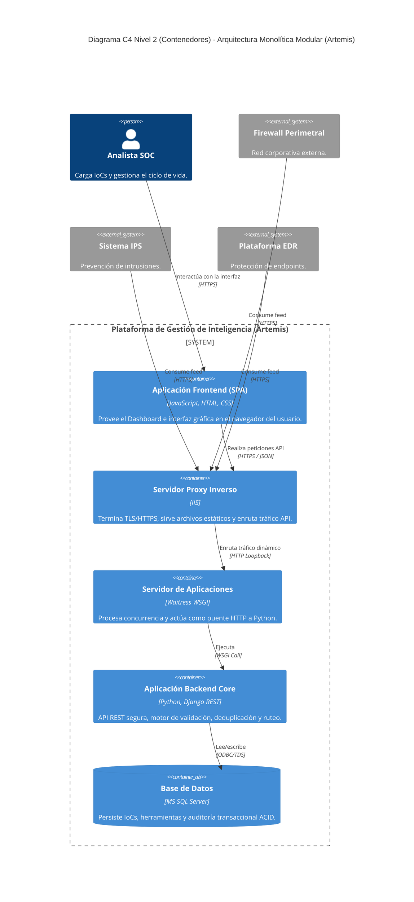
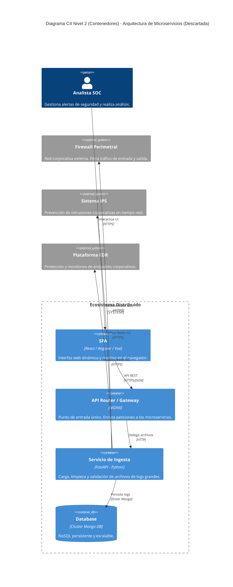
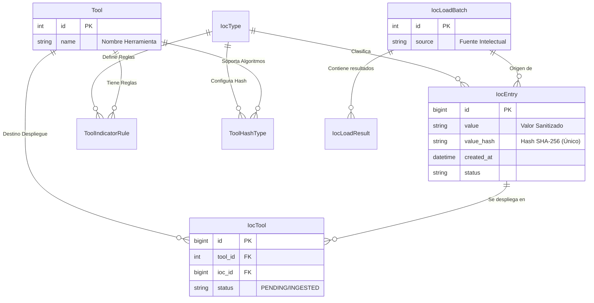
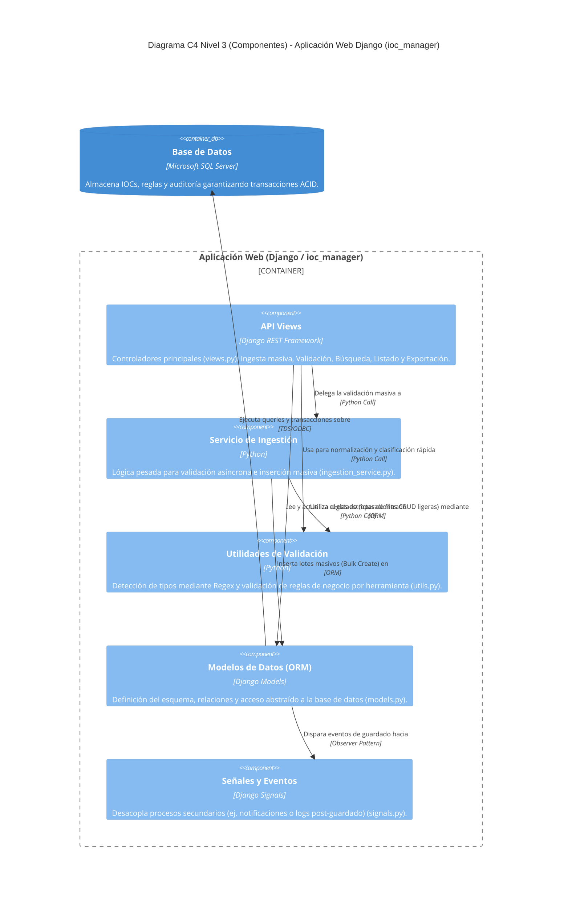

# Documentación Técnica y Funcional: Plataforma Centralizada de Orquestación de Inteligencia de Amenazas (Proyecto Artemis)

**Autor:** [Tu Nombre/El Alumno]  
**Institución:** [Nombre de la Institución]  
**Fecha:** [Fecha]  

---

## Resumen

El presente documento detalla la arquitectura, requerimientos y justificación técnica del **Proyecto Artemis**, una plataforma centralizada de orquestación de inteligencia de amenazas (Threat Intelligence Orchestration). El sistema ha sido diseñado para solucionar las ineficiencias en la gestión, normalización y distribución de Indicadores de Compromiso (IoCs) dentro de una entidad financiera, respetando estrictamente las restricciones de seguridad de un entorno corporativo basado en Windows Server On-Premise.

---

## 1. Planteamiento del Problema y Justificación

### 1.1. Descripción de la Problemática
En el panorama actual de ciberseguridad, las entidades financieras reciben miles de Indicadores de Compromiso (IoCs) provenientes de múltiples fuentes de inteligencia (OSINT, CERTs, proveedores comerciales). Históricamente, la integración de estos indicadores hacia las herramientas de defensa perimetral (Firewalls, Proxies) y de endpoint (EDR) se ha realizado de manera manual o mediante scripts fragmentados.

Esta falta de orquestación centralizada genera un impacto directo en la capacidad de respuesta del Centro de Operaciones de Seguridad (SOC). 

### 1.2. Evidencia Cuantitativa e Impacto Operativo
Basado en estimaciones estándar de la industria bancaria para equipos SOC de tamaño medio, el manejo manual de inteligencia de amenazas presenta las siguientes deficiencias cuantitativas:
*   **Tiempo Medio de Respuesta (MTTR):** Los analistas demoran en promedio **45 minutos** desde la recepción de un boletín de seguridad crítico hasta el despliegue efectivo de los bloqueos en todas las consolas defensivas.
*   **Afectación Operativa (Carga Laboral):** El equipo destina aproximadamente **15 a 20 horas semanales** exclusivamente a tareas repetitivas de depuración, eliminación de duplicados y formateo de IoCs, tiempo que debería invertirse en el análisis activo de amenazas (Threat Hunting).
*   **Niveles de Servicio (SLA):** La latencia introducida por el error humano y el procesamiento manual incrementa la ventana de exposición (Window of Exposure) ante ataques de Día Cero, poniendo en riesgo el cumplimiento de los SLAs internos de ciberseguridad.

La implementación de Artemis busca automatizar este flujo, reduciendo el MTTR a **menos de 5 minutos** y liberando más de **60 horas-hombre al mes**.

---

## 2. Especificación de Requerimientos

Para resolver la problemática planteada y alinearse con las necesidades reales de la operación, se definieron los siguientes requerimientos.

### 2.1. Requerimientos Funcionales
1.  **Ingesta Masiva de Inteligencia:** El sistema debe permitir la carga masiva de IoCs mediante archivos de texto plano o entrada directa.
2.  **Validación y Normalización:** El sistema debe clasificar y validar automáticamente los indicadores (IPs, Dominios, URLs, y Hashes) mediante el uso de expresiones regulares (Regex) y validación de longitud (ej. diferenciar MD5, SHA-1 y SHA-256).
3.  **Filtrado de Errores y Duplicados:** El sistema debe rechazar indicadores malformados y evitar la inserción de duplicados en la base de datos (Zero Redundancy).
4.  **Enrutamiento Basado en Reglas:** El sistema debe distribuir los IoCs únicamente a las herramientas de seguridad compatibles (ej. enviar Hashes al EDR y bloquear su envío al Firewall perimetral).
5.  **Trazabilidad y Auditoría:** El sistema debe registrar un historial detallado del estado de ingesta y validación de cada lote de IoCs procesado.

### 2.2. Requerimientos No Funcionales
1.  **Restricción de Entorno Operativo:** El sistema debe ser 100% compatible y desplegable en un entorno cerrado **Windows Server 2019/2022 On-Premise**, utilizando **Internet Information Services (IIS)** y **Microsoft SQL Server**. No se permite el uso de servicios en la nube pública ni orquestadores de contenedores en Linux.
2.  **Rendimiento:** El procesamiento, validación e inserción en base de datos de un lote estándar de 5,000 indicadores debe realizarse en un tiempo no mayor a 5 segundos.
3.  **Seguridad y Control de Acceso:** El sistema debe estar protegido contra vulnerabilidades del Top 10 de OWASP (ej. inyección SQL, CSRF) e implementar autenticación robusta mediante algoritmos de hashing PBKDF2.

---

## 3. Alternativas Arquitectónicas

Para abordar los requerimientos, se evaluaron dos arquitecturas de software. A continuación se presentan los diagramas C4 (Nivel 2: Contenedores) de ambas alternativas y su respectivo análisis.

### 3.1. Alternativa 1: Arquitectura Monolítica Modular (Solución Seleccionada)
Esta alternativa propone una aplicación web monolítica construida sobre el framework Django (Python), la cual centraliza tanto la lógica de backend como la interfaz de usuario en un solo despliegue cohesivo.

**Diagrama C4 Nivel 2: Contenedores - Alternativa 1**

**Justificación de Selección:**
Esta arquitectura cumple íntegramente con el Requerimiento No Funcional de operar en el entorno restrictivo del banco. Se integra nativamente con IIS (mediante Waitress) y con Microsoft SQL Server. Al ser un monolito modular, reduce drásticamente la latencia de red interna, facilita el despliegue en un único servidor Windows y simplifica el mantenimiento, reduciendo los puntos de falla sin sacrificar la seguridad.

### 3.2. Alternativa 2: Arquitectura de Microservicios (Solución Descartada)
Esta alternativa propone dividir el sistema en múltiples servicios independientes y contenerizados, separando estrictamente el frontend del backend y dividiendo la lógica de negocio (validación, ingesta y autenticación) en contenedores asíncronos.

**Diagrama C4 Nivel 2: Contenedores - Alternativa 2**

**Justificación de Descarte:**
La arquitectura de microservicios, apoyada por colas de mensajería (RabbitMQ) y bases de datos especializadas (NoSQL), se justificaría plenamente en un escenario donde la aplicación deba escalar horizontalmente a millones de transacciones por segundo, o donde múltiples células de desarrollo trabajen en despliegues independientes sin afectar la disponibilidad del frontend. 

Sin embargo, **esta alternativa es descartada** por las siguientes razones de peso:
1.  **Incompatibilidad y Restricción de Entorno:** El orquestador necesario para sostener esta malla de servicios (como Kubernetes o Docker Swarm) requeriría clústeres basados en sistemas operativos Linux o soluciones Cloud nativas. Esto incumple de forma directa la política de arquitectura de la entidad, que exige el despliegue en Windows Server On-Premise cerrado.
2.  **Complejidad y Sobrecarga Operativa (Overhead):** La volumetría proyectada para el proyecto Artemis (lotes de miles de IoCs diarios) es perfectamente manejable por un único motor de base de datos relacional y un servidor web bien optimizado. Introducir un API Gateway, Message Brokers y el monitoreo distribuido incrementaría enormemente la complejidad técnica, los costos de hardware y los tiempos de mantenimiento para el equipo de infraestructura, de manera totalmente injustificada para el alcance del problema.

---

## 4. Diseño y Modelo de Datos (C4 Nivel 3: Componentes de Datos)

La persistencia de datos (Alternativa 1) está diseñada bajo el principio de "Zero Redundancy", evitando la creación de tablas históricas innecesarias que comprometan el almacenamiento del servidor.

---

## 5. Controles de Seguridad Aplicativos

### 5.1. Seguridad de Acceso y Datos (Normativas OWASP)
*   **Gestión de Credenciales:** La plataforma emplea técnicas de hashing para el almacenamiento de contraseñas mediante el algoritmo PBKDF2 con SHA-256 y 600,000 iteraciones (Estándar recomendado por el NIST), previniendo ataques de fuerza bruta o Rainbow Tables.
*   **Prevención de Inyección SQL (SQLi):** Se hace uso estricto del mapeador objeto-relacional (ORM) de Django. Todas las interacciones con la base de datos se ejecutan como sentencias preparadas parametrizadas a nivel de driver ODBC.
*   **Prevención CSRF (Cross-Site Request Forgery):** Inclusión obligatoria de tokens criptográficos aleatorios y temporales en todas las solicitudes POST/PUT del sistema.

### 5.2. Seguridad en Red y Transporte
*   **Cifrado en Tránsito:** La integración entre el balanceador/proxy general de la institución y el servidor IIS local requiere el establecimiento de certificados TLS 1.2 o superior.
*   **Aislamiento del Servicio (Sandboxing):** El servidor de aplicaciones Waitress se ejecuta vinculado exclusivamente a la interfaz de bucle local (`localhost` / `127.0.0.1`), bloqueando cualquier acceso directo de red que no atraviese previamente los filtros de seguridad configurados en IIS.

---

## 6. Arquitectura Interna (C4 Nivel 3: Componentes)

Dado el análisis del código de la aplicación (Módulo `ioc_manager`), a continuación se detalla el diagrama C4 de Componentes (Nivel 3). Este diagrama ilustra cómo interactúan internamente las vistas API, los servicios de negocio, las utilidades y los modelos dentro del contenedor de la aplicación web Django.

