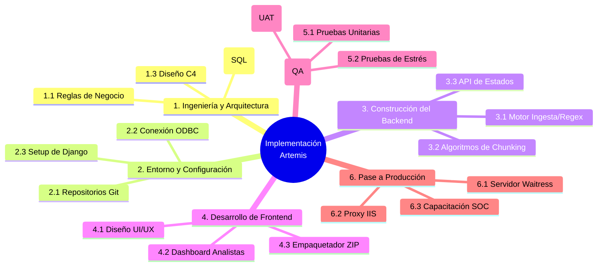
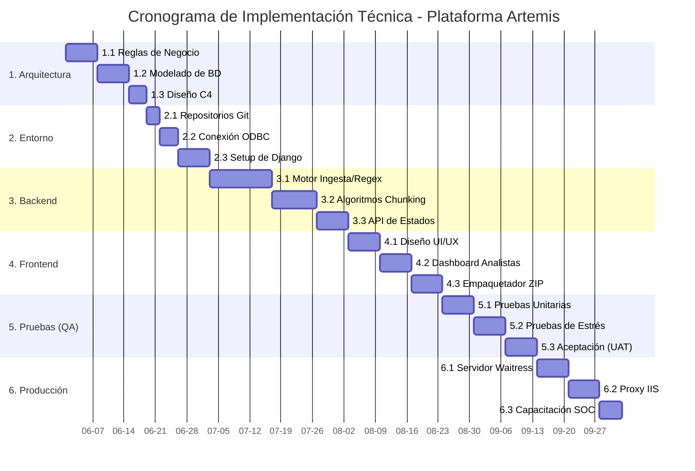

# Estructura de Desglose de Trabajo (EDT) - Implementación del Proyecto

**Proyecto:** Plataforma Artemis (Sistema Centralizado de Gestión del Ciclo de Vida de Inteligencia de Amenazas).
**Enfoque de la EDT:** Actividades Técnicas para el Desarrollo e Implementación del Sistema.

A continuación se presenta la Estructura de Desglose de Trabajo (EDT / WBS), enfocada estrictamente en el ciclo de vida de desarrollo de software y la implementación técnica del proyecto Artemis en un entorno corporativo real.

## Representación Gráfica (Mapa Mental de Implementación)

---

## Desglose Jerárquico Detallado

### **1. Fase de Ingeniería de Requisitos y Arquitectura**
Definición de las reglas operativas y la estructura subyacente del software.
*   **1.1** Levantamiento de Requerimientos y Reglas de Negocio (Filtros de SOC).
*   **1.2** Modelado Físico y Lógico de la Base de Datos Relacional (MS SQL Server).
*   **1.3** Diseño Arquitectónico de Software bajo el estándar C4 (Contexto y Contenedores).

### **2. Fase de Preparación de Entorno y Configuración Base**
Configuración de las herramientas necesarias para la programación y conexión.
*   **2.1** Aprovisionamiento de Repositorios (Git) y Control de Versiones.
*   **2.2** Configuración de Controladores ODBC para la conexión puente con SQL Server.
*   **2.3** Inicialización del Framework web Django (Python) y arquitectura MVT.

### **3. Fase de Construcción del Backend y Lógica de Negocio**
Programación del "cerebro" del sistema y el procesamiento masivo de datos.
*   **3.1** Desarrollo del Módulo de Ingesta y Clasificación Automatizada (Motor Regex).
*   **3.2** Implementación de Algoritmos de *Chunking* (Fragmentación) para procesar altos volúmenes sin *Timeouts*.
*   **3.3** Desarrollo de la API Interna para la actualización y Trazabilidad de Estados de IoCs.

### **4. Fase de Desarrollo de Frontend e Interfaces**
Construcción de las vistas con las que interactuará el usuario final.
*   **4.1** Prototipado interactivo y aplicación de estilos UI/UX (Bootstrap/CSS).
*   **4.2** Programación de *Dashboards* y Grillas de Control para los Analistas SOC.
*   **4.3** Desarrollo del Módulo de Generación y Empaquetado Automático de archivos (.TXT / .ZIP).

### **5. Fase de Aseguramiento de Calidad (QA) y Pruebas**
Validación de que el sistema cumple con la exigencia de la red corporativa.
*   **5.1** Ejecución de Pruebas Unitarias de Componentes (Validación de limpieza de strings).
*   **5.2** Pruebas de Estrés y Rendimiento (Inyección sostenida de >150,000 registros).
*   **5.3** Pruebas de Aceptación de Usuario (UAT) validando la interfaz operativa con los analistas SOC.

### **6. Fase de Pase a Producción y Despliegue**
Lanzamiento oficial de Artemis en la infraestructura final.
*   **6.1** Aprovisionamiento en Windows Server y configuración del servidor Python WSGI (Waitress).
*   **6.2** Configuración de Enrutamiento, Certificados HTTPS y Seguridad en MS IIS (Proxy Inverso).
*   **6.3** Despliegue final, Capacitación Técnica al equipo SOC y entrega de Manuales Operativos.

---

## Formato Tabular (Listo para copiar a Word)

| Fase de Implementación | ID | Nombre de la Tarea | Descripción / Entregable |
| :--- | :--- | :--- | :--- |
| **1. Ingeniería y Arquitectura** | 1.1 | Reglas de Negocio | Definición de flujos y requerimientos del sistema. |
| | 1.2 | Modelado de BD | Diagramas y creación de la Base de Datos en SQL Server. |
| | 1.3 | Diseño C4 | Planos arquitectónicos de contenedores y contexto. |
| **2. Entorno y Configuración** | 2.1 | Repositorios Git | Setup de control de versiones y entornos virtuales. |
| | 2.2 | Conexión ODBC | Configuración de enlaces entre Django y la base de datos. |
| | 2.3 | Setup de Django | Creación de esqueleto del proyecto y variables de entorno. |
| **3. Construcción del Backend** | 3.1 | Motor Ingesta/Regex | Procesamiento de texto plano y clasificación analítica. |
| | 3.2 | Algoritmos Chunking | Lógica para evasión de Timeouts en grandes inyecciones ACID. |
| | 3.3 | API de Estados | Lógica transaccional para modificar el estado de los IoCs. |
| **4. Desarrollo de Frontend** | 4.1 | Diseño UI/UX | Maquetado visual de la plataforma. |
| | 4.2 | Dashboard Analistas | Vistas de tablas dinámicas para el control de la inteligencia. |
| | 4.3 | Empaquetador ZIP | Motor de compilación para la exportación de archivos curados. |
| **5. Pruebas y Calidad (QA)** | 5.1 | Pruebas Unitarias | Testeo de código individual. |
| | 5.2 | Pruebas de Estrés | Test de rendimiento y concurrencia (>150k registros). |
| | 5.3 | Aceptación (UAT) | Simulacro de uso real con el cliente final (Equipo SOC). |
| **6. Pase a Producción** | 6.1 | Servidor Waitress | Alojamiento y despliegue del proyecto en Windows Server. |
| | 6.2 | Proxy IIS | Configuración de red y seguridad para la salida web. |
| | 6.3 | Capacitación SOC | Entrega del sistema y entrenamiento a los analistas de seguridad. |

---

## Cronograma de Ejecución (Diagrama de Gantt)

El siguiente gráfico ilustra la distribución temporal orientada exclusivamente a la implementación de software en un horizonte estimado de desarrollo (Ej. 4 meses o 16 semanas).

